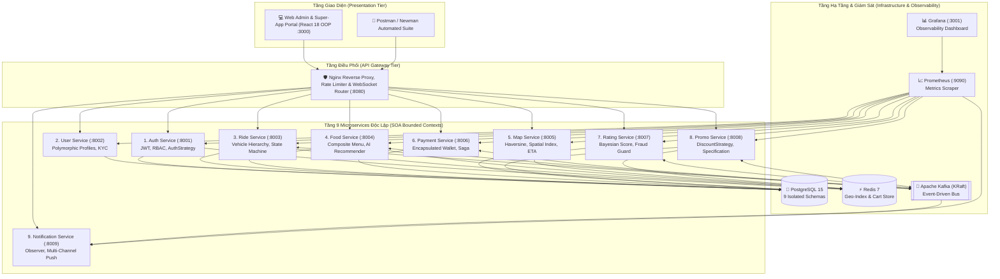

# 🏛️ Tài Liệu Kiến Trúc Hướng Dịch Vụ (SOA) & Lập Trình Hướng Đối Tượng (OOP) Chuyên Sâu — RideEat Super-App

## 1. Tổng Quan Kiến Trúc Hệ Thống (SOA Overview)

**RideEat** là siêu ứng dụng (Super-App) tích hợp **Đặt Xe Công Nghệ (Ride-Hailing)**, **Giao Đồ Ăn (Food Delivery)** và **Ví Điện Tử Đa Kênh (E-Wallet)** được thiết kế theo chuẩn **Service-Oriented Architecture (SOA)** kết hợp chặt chẽ với **Object-Oriented Programming (OOP)**, **Domain-Driven Design (DDD)** và **SOLID Principles**.

### Sơ Đồ Kiến Trúc Tổng Thể (Mermaid Architecture Diagram)

---

## 2. Chứng Minh 4 Trụ Cột Hướng Đối Tượng (4 Pillars of OOP)

| Trụ Cột OOP | Triển Khai Cụ Thể Trong RideEat SOA | Minh Chứng Kỹ Thuật |
| :--- | :--- | :--- |
| **1. Tính Đóng Gói (Encapsulation)** | Bảo vệ trạng thái nội tại của các thực thể quan trọng bằng thuộc tính private (`__balance`, `__id`, `__password_hash`, `#authToken`). | Trong `payment-service`, số dư ví `Wallet.__balance` không thể bị gán trực tiếp từ bên ngoài mà bắt buộc phải gọi phương thức kiểm duyệt nguyên tử `credit(amount)` hoặc `debit(amount)` có kiểm tra số dư tối thiểu và ghi nhận sổ cái `WalletTransaction`. |
| **2. Tính Kế Thừa (Inheritance)** | Tái sử dụng mã nguồn và thiết lập phân cấp kiểu rõ ràng thông qua lớp cơ sở dùng chung (`BaseEntity`, `AggregateRoot`, `AbstractVehicle`, `BaseUserProfile`, `BaseApiClient`). | Trong `ride-service`, các lớp `BikeVehicle`, `Car4SeatVehicle`, `Car7SeatVehicle`, `LuxuryLimousineVehicle` kế thừa từ `AbstractVehicle`. Trên Frontend, 7 dịch vụ API kế thừa từ `BaseApiClient`. |
| **3. Tính Đa Hình (Polymorphism)** | Cùng một giao diện phương thức nhưng hành vi thực thi tự động biến đổi theo từng lớp con lúc runtime. | Lời gọi `vehicle.calculate_base_fare(distance_km, duration_min)` hoặc `discount_strategy.calculate_discount(order_amount)` hoặc `payment_strategy.process_payment(request)` tự động thực thi thuật toán riêng của từng đối tượng mà không cần chuỗi `if/else` cứng nhắc. |
| **4. Tính Trừu Tượng (Abstraction)** | Tách biệt hoàn toàn giao diện nghiệp vụ (Interface / Abstract Base Class) khỏi chi tiết hạ tầng bên dưới. | Mọi tầng truy xuất dữ liệu kế thừa `IRepository[T]` (`ABC`), mọi bộ tính giá kế thừa `IPricingStrategy`, mọi kênh thông báo kế thừa `INotificationChannel`. |

---

## 3. Áp Dụng Nguyên Lý SOLID & 7 Design Patterns Kinh Điển

### 3.1. Sơ Đồ Lớp UML Trọng Tâm (Mermaid Class Diagram)

```mermaid
classDiagram
    class AbstractVehicle {
        <<abstract>>
        +String vehicle_type
        +float base_fare
        +float per_km_rate
        +float per_minute_rate
        +calculate_base_fare(distance_km, duration_min)* float
    }
    class BikeVehicle {
        +calculate_base_fare(distance_km, duration_min) float
    }
    class Car4SeatVehicle {
        +calculate_base_fare(distance_km, duration_min) float
    }
    class Car7SeatVehicle {
        +calculate_base_fare(distance_km, duration_min) float
    }
    class LuxuryLimousineVehicle {
        +calculate_base_fare(distance_km, duration_min) float
    }

    AbstractVehicle <|-- BikeVehicle
    AbstractVehicle <|-- Car4SeatVehicle
    AbstractVehicle <|-- Car7SeatVehicle
    AbstractVehicle <|-- LuxuryLimousineVehicle

    class IPricingStrategy {
        <<interface>>
        +apply_multiplier(base_amount, context)* float
    }
    class NormalPricingStrategy {
        +apply_multiplier(base_amount, context) float
    }
    class SurgePricingStrategy {
        +apply_multiplier(base_amount, context) float
    }
    class RainyWeatherPricingStrategy {
        +apply_multiplier(base_amount, context) float
    }

    IPricingStrategy <|.. NormalPricingStrategy
    IPricingStrategy <|.. SurgePricingStrategy
    IPricingStrategy <|.. RainyWeatherPricingStrategy
```

### 3.2. Danh Mục 7 Design Patterns Trong 9 Microservices

1. **Strategy Pattern (Chiến lược thuật toán hoán đổi động):**
   - `auth-service`: `PasswordAuthStrategy`, `OTPAuthStrategy`, `RefreshTokenStrategy`.
   - `ride-service`: `NormalPricingStrategy`, `SurgePricingStrategy`, `RainyWeatherPricingStrategy`.
   - `payment-service`: `WalletPaymentStrategy`, `VNPayPaymentStrategy`, `MoMoPaymentStrategy`, `CashPaymentStrategy`.
   - `promo-service`: `PercentageDiscountStrategy`, `FixedAmountDiscountStrategy`, `FreeDeliveryStrategy`, `TieredDiscountStrategy`.
   - `rating-service`: `BayesianWeightedAverageStrategy`.
2. **Factory Method Pattern (Nhà máy khởi tạo đối tượng):**
   - `VehicleFactory`, `PaymentProcessorFactory`, `AuthStrategyFactory`, `NotificationChannelFactory`.
3. **State Pattern (Máy trạng thái vòng đời đơn hàng):**
   - Kiểm soát chặt chẽ chuyển đổi trạng thái hợp lệ của Chuyến xe (`REQUESTED -> DRIVER_ASSIGNED -> ARRIVING -> IN_PROGRESS -> COMPLETED / CANCELLED`) và Đơn đồ ăn (`PENDING -> CONFIRMED -> PREPARING -> PICKING_UP -> DELIVERING -> DELIVERED`).
4. **Decorator Pattern (Bọc mở rộng tính năng động):**
   - Bọc đối tượng tính cước chuyến xe bằng `InsuranceFeeDecorator` (+3.000đ bảo hiểm) và `PriorityDispatchDecorator` (+10.000đ ưu tiên điều phối) tuân thủ đúng nguyên lý Open/Closed (OCP).
5. **Composite Pattern (Cấu trúc cây thực đơn):**
   - Trong `food-service`, `MenuComponent` cho phép xử lý đồng nhất giữa món lẻ (`MenuItemLeaf`) và gói combo nhiều món (`ComboMealComposite`) khi tính giá và tổng calo.
6. **Specification Pattern (Chuỗi quy tắc kiểm duyệt khuyến mãi):**
   - Trong `promo-service`, các điều kiện `MinOrderAmountSpec`, `TimeWindowSpec`, `UsageQuotaSpec` có thể kết hợp bằng toán tử logic `AND`/`OR` để kiểm tra tính hợp lệ của Voucher.
7. **Observer / Event-Bus & Circuit Breaker Pattern (Giao tiếp hướng sự kiện & Chịu lỗi):**
   - Phát và lắng nghe `DomainEvent` qua Apache Kafka (`ride.events`, `food.events`, `payment.events`) kết hợp `CircuitBreaker` tự động ngắt mạch khi dịch vụ đích quá tải.
